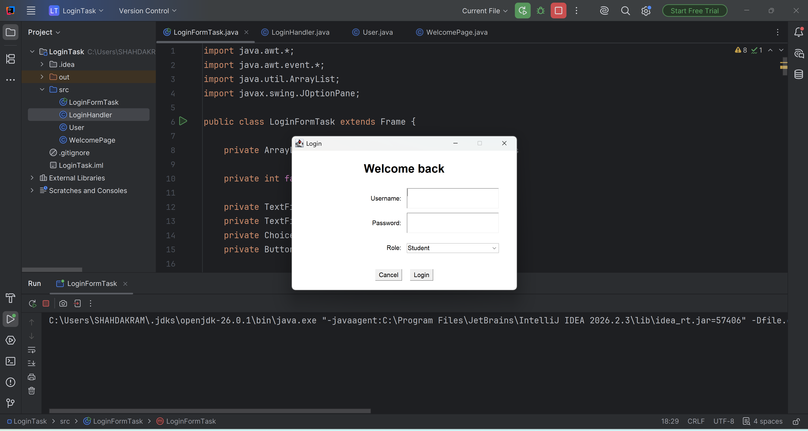
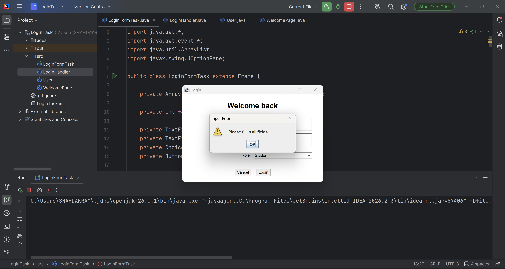
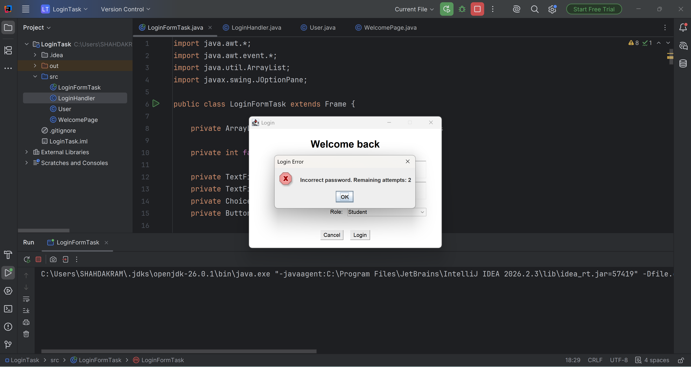
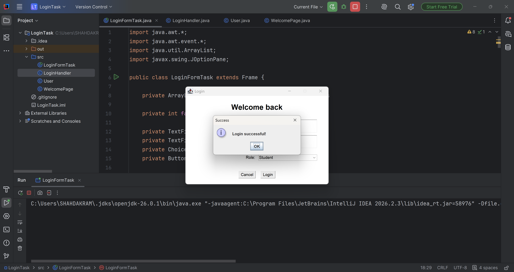
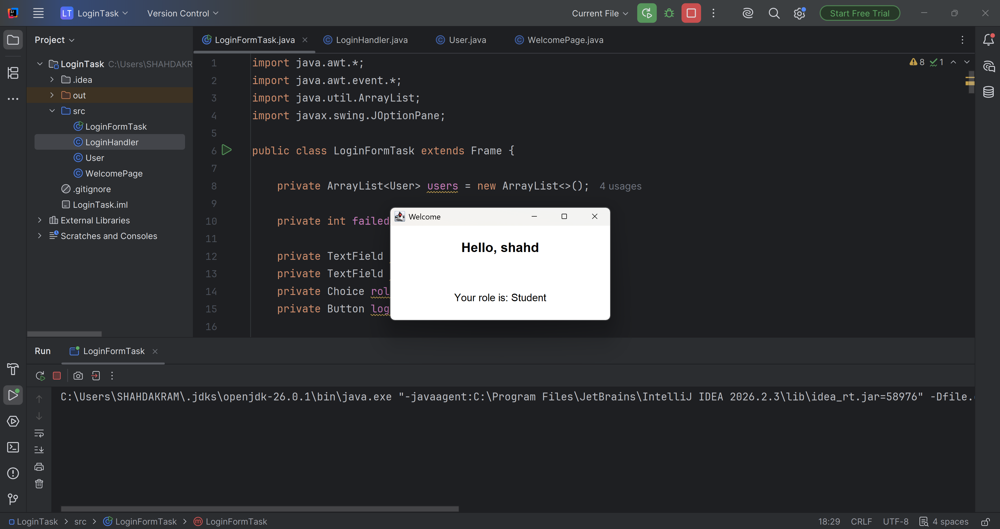

# Java Login System

## Project Description

A simple Login System developed using Java AWT.

The application allows users to log in using a username, password, and role. It also validates user input and limits failed password attempts.

## Features

* User login validation.
* Username and password verification.
* Role selection (Student, TA, Professor).
* Input validation for empty fields.
* Maximum of 3 incorrect password attempts.
* Welcome page displayed after successful login.
* Cancel button to close the application.

## Technologies Used

* Java
* Java AWT
* Java Event Handling

## Test Accounts

| Username | Password | Role      |
| -------- | -------- | --------- |
| shahd    | 1234     | Student   |
| ahmed    | 5678     | TA        |
| sara     | 9876     | Professor |

## Screenshots

### Login Form

### Empty Fields Validation

### Wrong Password Validation

### Username Does Not Exist

### Three Failed Attempts

.png)

### Successful Login

## How to Run

1. Open the project in IntelliJ IDEA.
2. Open `src/LoginFormTask.java`.
3. Run the `main` method.

## Author

Shahd Akram Elkady
